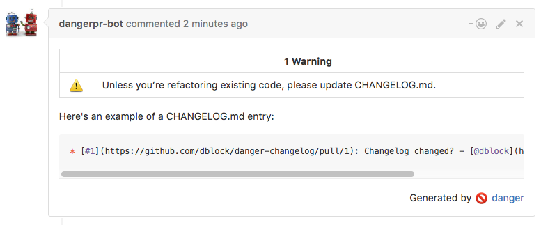
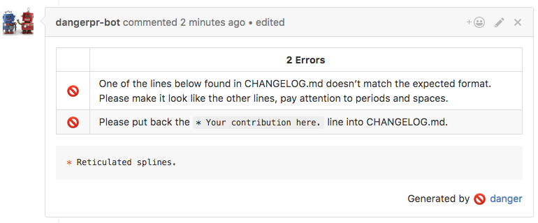

# Danger-Changelog

A plugin for [danger.systems](https://danger.systems) that obsessive-compulsively lints your project’s `CHANGELOG.md`. It can make sure, for example, that changes are attributed properly, have a valid version number, a date in the ISO8601 format, balanced parenthesis and brackets, and that they’re always terminated with a period.

[](https://badge.fury.io/rb/danger-changelog)
[](https://github.com/dblock/danger-changelog/actions/workflows/test.yml)

# Table of Contents

- [What’s a correctly formatted CHANGELOG file?](#whats-a-correctly-formatted-changelog-file)
- [Installation](#installation)
- [Usage](#usage)
- [Configuration](#configuration)
  - [changelog.filename](#changelogfilename)
  - [changelog.format](#changelogformat)
  - [changelog.placeholder_line](#changelogplaceholder_line)
  - [changelog.ignore_files](#changelogignore_files)
  - [Conditional reminders](#conditional-reminders)
- [Checks](#checks)
  - [changelog.check!](#changelogcheck)
    - [changelog.have_you_updated_changelog?](#changeloghave_you_updated_changelog)
    - [changelog.is_changelog_format_correct?](#changelogis_changelog_format_correct)
- [Contributing](#contributing)
- [Copyright](#copyright)

## What's a correctly formatted CHANGELOG file?

By design, `danger-changelog` is quite strict with what it allows as a valid changelog file, using the [Intridea style](doc/intridea.md), [used by this library itself](CHANGELOG.md). It also supports the [Keep a Changelog](doc/keep_a_changelog.md) format.

## Installation

Requires Ruby 3.1 or newer. Add `danger-changelog` to your Gemfile.

```
gem 'danger-changelog'
```

Call `changelog.check!` from your `Dangerfile`. Make a pull request and see this plugin in action.

## Usage

Methods and attributes from this plugin are available in your `Dangerfile` under the `changelog` namespace.

## Configuration

Every option can be set globally on `changelog` or passed as a keyword to a check. Per-check keywords override global defaults only for that call; parsing and reports use an immutable snapshot. Unknown options and invalid values raise `ArgumentError`.

```ruby
changelog.ignore_files = ['README.md', /\.txt$/]
changelog.check!
changelog.check!(filename: 'packages/api/CHANGELOG.md')
changelog.check!(filename: 'CHANGES.md', format: :keep_a_changelog)
```

Global strings and arrays are copied and frozen; assign a new value rather than modifying a setting in place. The deprecated `Danger::Changelog.configure` block still sets global defaults.

### changelog.filename

Set the CHANGELOG file name, defaults to `CHANGELOG.md`.

```ruby
changelog.filename = 'CHANGES.md'
changelog.check!(filename: 'CHANGES.md')
```

### changelog.format

Set the format of the CHANGELOG file.

```ruby
changelog.format = :keep_a_changelog
changelog.check!(format: :keep_a_changelog)
```

Available formats are [Intridea](doc/intridea.md) (default) and [Keep a Changelog](doc/keep_a_changelog.md). Symbol and string format names are accepted.

### changelog.placeholder_line

Customize the `* Your contribution here.` line. Set the value to `nil` to stop checking for one.

```ruby
changelog.placeholder_line = "* Your change here.\n"
changelog.check!(placeholder_line: 'Your change here.')
```

The leading `* ` and trailing newline are added when omitted. This option applies to the Intridea parser; Keep a Changelog does not require a placeholder.

### changelog.ignore_files

Ignore additions and changes with a certain name or expression, default is to ignore `README.md` changes.

For example, ignore `UPGRADING.md` and all `.txt` files.

```ruby
changelog.ignore_files = ['README.md', 'UPGRADING.md', /\.txt$/]
changelog.check!(ignore_files: ['README.md', 'UPGRADING.md', /\.txt$/])
```

### Conditional reminders

By default, only `README.md` is ignored. To skip reminders when all added or modified files are documentation at the repository root, use an anchored pattern. Subdirectory files still require a changelog update.

```ruby
changelog.ignore_files = [/\A[^\/]+\.md\z/]
changelog.check!
```

For code-only reminders, use Danger's changed files directly. Keep format validation unconditional, so an edited changelog is checked even when no code changes:

```ruby
changed_files = git.modified_files + git.added_files + git.deleted_files
changelog.have_you_updated_changelog? if changed_files.any? { |file| file.start_with?('lib/') }
changelog.is_changelog_format_correct?
```

Other policies can use the same separate checks, such as reminding only for changes larger than 50 lines unless the pull request is marked trivial:

```ruby
declared_trivial = github.pr_labels.include?('trivial')
changelog.have_you_updated_changelog? if git.lines_of_code > 50 && !declared_trivial
changelog.is_changelog_format_correct?
```

The label example uses the GitHub plugin; adapt the condition to your provider. Do not also call `check!` in these conditional examples, because it would run the reminder unconditionally.

## Checks

All checks accept the same configuration keywords: `filename`, `format`, `placeholder_line`, and `ignore_files`. Each uses only the relevant settings.

### changelog.check!

Run all checks with defaults, including `have_you_updated_changelog?` and `is_changelog_format_correct?`.

```ruby
changelog.check!(filename: 'CHANGES.md', placeholder_line: nil)
```

As before, format validation runs only if the update reminder passes. The deprecated `check` also accepts keyword overrides and its legacy positional format, without modifying global defaults.

#### changelog.have_you_updated_changelog?

Checks whether you have updated CHANGELOG.md.

```ruby
changelog.have_you_updated_changelog?(filename: 'CHANGES.md', ignore_files: [/\.md$/])
```



#### changelog.is_changelog_format_correct?

Checks whether the CHANGELOG format is correct.

```ruby
changelog.is_changelog_format_correct?(filename: 'CHANGES.md', format: :keep_a_changelog)
```

The change predicates `changelog_changes?` and `file_changes?` accept the same keywords, for example `changelog.changelog_changes?(filename: 'CHANGES.md')`.



## Contributing

See [CONTRIBUTING](CONTRIBUTING.md).

## Copyright

Copyright (c) Daniel Doubrovkine, 2016-2019

MIT License, see [LICENSE](LICENSE.txt) for details.
